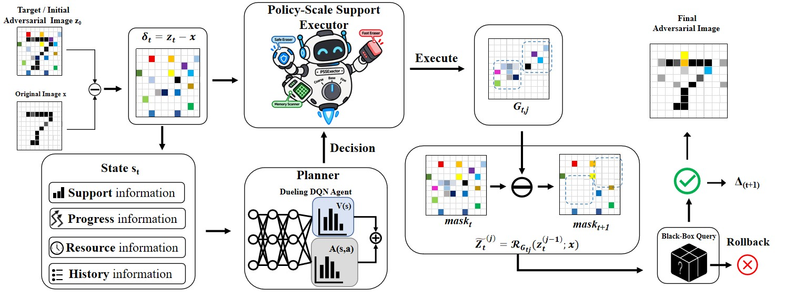

# RLGPA: Reinforcement Learning-Guided Granularity Planning Attack

RLGPA is a decision-based black-box attack for generating sparse adversarial examples under a limited query budget. The attack assumes access only to the victim model's top-1 predicted label and progressively reduces the perturbation support while preserving adversarial feasibility.

## Overview

*Overview of RLGPA. The planner selects a policy-scale action from the current attack state, and PSSE performs hard-label-verified support restoration under the query budget.*

The key idea of RLGPA is to formulate sparse support reduction as an online scheduling problem. Instead of assigning reinforcement-learning actions directly to image-dependent pixel indices, RLGPA defines stable policy-scale actions. These actions determine both the support-reduction strategy and the relative granularity used at the current attack stage.

A masked Dueling Double DQN observes compact information about the current support, recent progress, remaining query budget, and action history. It then selects a policy-scale action for the Policy-Scale Support Executor (PSSE). PSSE constructs restoration groups from the current perturbation support, evaluates them through hard-label queries, and commits a restoration only when the resulting image remains adversarial. The observed support reduction and query cost are returned to the planner for online learning.

This design allows the planner to reuse experience across changing support partitions and across images while maintaining the hard-label adversarial constraint throughout the attack.

## Evaluation

RLGPA is evaluated on targeted and untargeted sparse attacks using:

- CIFAR-10 with ResNet-18;
- ImageNet with ResNet-50;
- ImageNet with Vision Transformer (ViT) models.

The evaluation considers query-sparsity behavior, attack success rates at fixed sparsity thresholds, planner attribution, state and reward ablations, executor and granularity ablations, and frozen-policy evaluation on disjoint probe images.

## Evaluation Protocol

To ensure a controlled comparison with prior decision-based sparse attacks, RLGPA follows the evaluation protocol of [SparseEvoAttack (SEA)](https://github.com/SparseEvoAttack/SparseEvoAttack.github.io) wherever applicable. In particular, the adversarial initialization procedure, source-target construction, evaluation samples, victim-model preprocessing, and hard-label success criterion are aligned with SEA. RLGPA changes the subsequent support-reduction strategy: its online planner and PSSE decide how the initialized adversarial support is progressively restored under the same query-based setting.

## Code Availability

The manuscript describing RLGPA is currently under peer review. The complete source code, official configurations, evaluation scripts, and reproduction instructions will be made publicly available upon acceptance.

Until then, this repository serves as a project page for the work.

